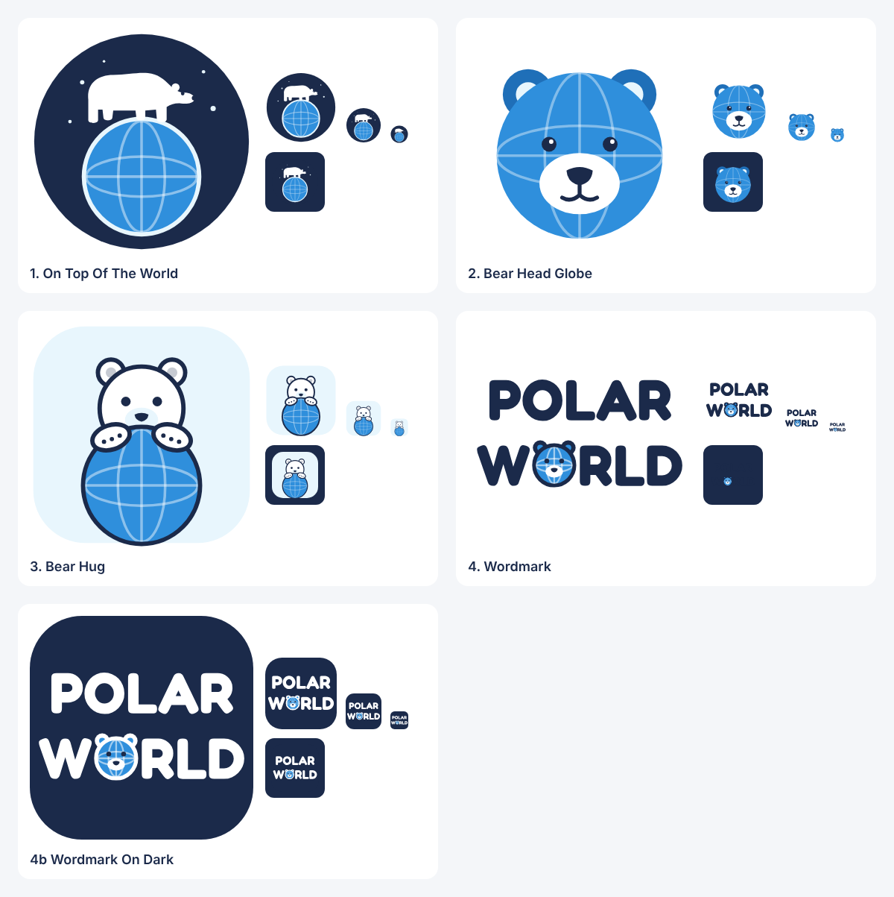

# Polar World logo concepts

Four ideas for Polar World: a polar bear and a world. They're flat and simple, in one palette (navy `#1b2a4a`, ocean `#2f8fdc`, ice `#e8f6fd`, white), and every file is a self-contained SVG.



| File | Idea | Best for |
|---|---|---|
| `1-on-top-of-the-world.svg` | A polar bear walking across the top of the globe, white on a navy badge with stars | Badges, stickers, merch |
| `2-bear-head-globe.svg` | The bear's head *is* the world: globe lines, ears, eyes and a snout | App icons and avatars (it reads at 24 px) |
| `3-bear-hug.svg` | A bear peeking over the world, paws wrapped around it | Friendly brand mark, kids' products |
| `4-wordmark.svg`, `4b-wordmark-on-dark.svg` | POLAR WORLD, with the O as a globe with bear ears | Website header, signs, letterhead |

The wordmark letters are Fredoka Bold converted to outlines, so the SVG doesn't need the font installed. To change any concept, edit `make.cjs` and run:

```bash
npm i opentype.js @fontsource/fredoka   # once, in this folder
node make.cjs .
```
